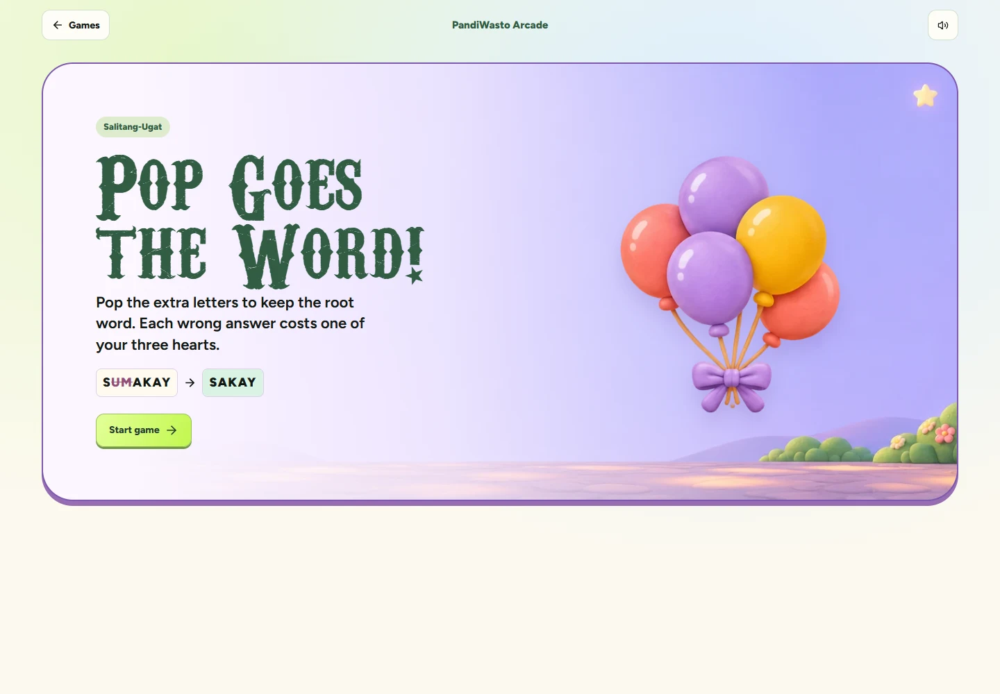

# PandiWasto

PandiWasto is a Filipino morphology arcade. Players practice seven word-formation lessons, earn XP to unlock games, and compare scores on per-game leaderboards. The app estimates skill mastery using Bayesian Knowledge Tracing (BKT) and supports a study comparing three ways to deliver hints in Filipino.

## Screenshots

### Landing page


### Arcade dashboard


### Pop Goes the Word



## Tech stack

| Layer | Tools |
| --- | --- |
| Frontend | React, TypeScript, Vite, Tailwind CSS, Radix UI, Lenis |
| Gameplay backend | Supabase Edge Functions, Deno, Zod |
| Accounts and data | Supabase Auth, PostgreSQL, row-level security, SQL migrations |
| Learning and hints | Bayesian Knowledge Tracing, authored Filipino hints, optional Google Gemini |
| Verification | ESLint, TypeScript, Deno tests |

## Run locally

Install Node.js 24 and run these commands from the repository root.

```bash
npm run install-all
npm run dev
```

Open [PandiWasto](http://localhost:5173) and choose **Log in** to sign in or create an account. Configure the frontend to use a Supabase project with the `arcade` function deployed before testing gameplay.

## Arcade games

Players start at Level 1. Every 100 XP raises the player one level.

| Game | Unlock | Lesson and controls | Scoring and XP |
| --- | ---: | --- | --- |
| Pop Goes the Word | 1 | **Salitang-Ugat**. Pop extra letters, then check the root word. Tap a popped spot to restore its balloon. | Five rounds with three hearts per run. Each wrong check costs a heart. Solved rounds earn up to 100 points and 20 XP each. Running out of hearts saves the points and XP already earned. |
| Whack-a-Word | 3 | **Kayarian ng Salita**. Pick Payak, Maylapi, Tambalan, or Inuulit before the mole ducks. The 1–4 keys also select a type. | Three lives. Each correct answer earns 100 points and 10 XP. A miss or timeout costs one life. Untimed practice earns XP. Only timed runs save a best score. |
| Toss-a-Lapi | 5 | **Mga Panlapi**. Tap or drag an affix tile into each sentence. | Five rounds, up to 500 points, and 100 XP on completion. |
| Memory Match | 7 | **Tambalan**. Flip cards in pairs to combine root words. Each board ends with a review of the compounds and their meanings. | Three boards with 6, 8, and 10 cards. Up to 1,200 points and 100 XP on completion. |
| Ticket Stub Dispenser | 9 | **Pag-uulit**. Pull the Ganap or Parsiyal lever to print a pair of full tickets or a full ticket with a short stub. | Five rounds, up to 500 points, and 100 XP on completion. |
| Claw Machine | 11 | **Pokus ng Pandiwa**. Aim with the arrow buttons or pick a doll, then press Grab. Each run covers Tagaganap, Layon, Ganapan, and Tagatanggap. | Five rounds, up to 500 points, and 100 XP on completion. |
| Fortune Predict | 13 | **Asimilasyon**. Predict whether pang- becomes pam-, becomes pan-, or stays pang- when joined to a root word. Choose the word and print the card. | Five rounds, up to 500 points, and 100 XP on completion. |

The arcade has animated score updates, visual success and retry cues, and a sound toggle in every game. Sound starts on. Motion effects respect the browser’s reduced-motion preference. Use the Lessons tab for examples and links to each game.

## Account play and database setup

1. Apply all six [migrations](supabase/migrations) in filename order to a staging Supabase project, then verify the staging rollout before applying them to production.
2. Deploy the `arcade` Edge Function to the same Supabase project. The function uses Supabase’s built-in project URL and server key.
3. Copy `frontend/.env.local.example` to `frontend/.env.local` and set `VITE_SUPABASE_URL` and `VITE_SUPABASE_PUBLISHABLE_KEY` using that project’s browser publishable key. Enable email sign-in and allow the local or deployed frontend URL in Supabase Auth.

The server validates account game moves before saving XP, levels, and best scores. Signed-in Rankings shows generated aliases, avatars, levels, and validated scores. Whack-a-Word practice earns XP and stays out of Rankings. The header avatar opens the menu for Profile, Settings, and Sign out.

## Deploy

From the repository root, sign in to the Supabase CLI and deploy the function to the project where you applied the migrations. Replace `YOUR_PROJECT_REF` with the project reference.

```bash
npx supabase login
npx supabase functions deploy arcade --remote=YOUR_PROJECT_REF --use-api
```

1. Import the repository into Vercel. Choose the **Vite** preset, set the root directory to `frontend`, use `npm run build`, and publish `dist`.
2. Set `VITE_SUPABASE_URL` and `VITE_SUPABASE_PUBLISHABLE_KEY` in Vercel and add the frontend URL to the Supabase Auth redirect allowlist. For an existing deployment, remove the obsolete `VITE_API_URL` and redeploy the frontend.
3. Check `/functions/v1/arcade/health` on the Supabase project URL, then confirm email sign-in, score saving, and Rankings on the deployed frontend.

Supabase Auth verifies the user token on every protected function request. Set the optional `ARCADE_ALLOWED_ORIGINS` Edge Function secret to a comma-separated list of frontend origins if you want to limit browser access. Set the optional `GEMINI_API_KEY` only in Edge Function secrets to enable generated hints.

See the [Supabase Edge deployment guide](https://supabase.com/docs/guides/functions/deploy), [Vercel guide for Vite](https://vercel.com/docs/frameworks/frontend/vite), and [frontend environment template](frontend/.env.local.example).

## Verify locally

```bash
npm run lint --prefix frontend
npm run build --prefix frontend
deno test --config supabase/functions/arcade/deno.json supabase/functions/arcade
```

## Administration and study

- **Admin** can look up a score by player alias or account ID and hide or restore it with a recorded reason. Admins can also configure a cohort, add separate pre- and post-assessments, and invite approved participants.
- **Study** shows invitations, participation and withdrawal controls, assessments, and the scheduled practice window. The database assigns conditions privately and excludes withdrawn participants from future research exports.
- **Mastery** in Lessons is based on recorded first unaided answers across the ten configured skills. Authored hints work locally. Account Pop Goes the Word supports the optional server-only Gemini provider and falls back to an authored hint on failure.

The [implementation plan](IMPLEMENTATION.md) lists the database rollout, backend and admin interfaces, per-game validation work, security tests, and research dependencies. See also the [technical draft](Technical-draft) and [research brief](skill.md).
