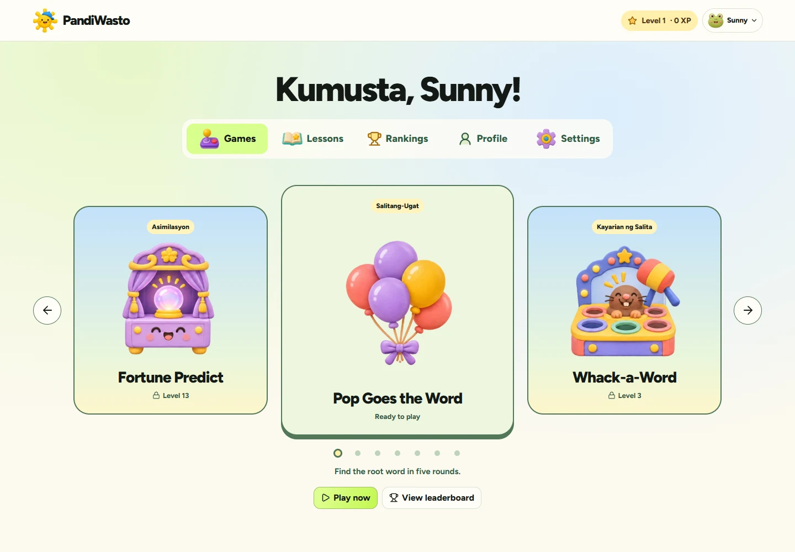

# PandiWasto

PandiWasto is a Filipino morphology arcade. Players practice seven word-formation lessons, earn XP to unlock games, and compare scores on per-game leaderboards. The app estimates skill mastery using Bayesian Knowledge Tracing (BKT) and supports a study comparing three ways to deliver hints in Filipino.

## Screenshots

### Landing page


### Arcade dashboard



### Pop Goes the Word


## Tech stack

| Layer | Tools |
| --- | --- |
| Frontend | React, TypeScript, Vite, Tailwind CSS, Radix UI, Lenis |
| Backend | Node.js 24, Express, Zod |
| Accounts and data | Supabase Auth, PostgreSQL, row-level security, SQL migrations |
| Learning and hints | Bayesian Knowledge Tracing, authored Filipino hints, optional Google Gemini |
| Verification | ESLint, TypeScript, Node.js test runner |

## Run locally

Install Node.js 24 and run these commands from the repository root.

```bash
npm run install-all
npm run dev
```

Open [PandiWasto](http://localhost:5173) and choose **Log in** to sign in or create an account. Configure Supabase and the API using the steps below before testing gameplay. Run `npm run dev:frontend` to start only the frontend.

## Arcade games

Players start at Level 1. Every 100 XP raises the player one level.

| Game | Unlock | Lesson and controls | Scoring and XP |
| --- | ---: | --- | --- |
| Pop Goes the Word | 1 | **Salitang-Ugat**. Pop extra letters, then check the root word. Tap a popped spot to restore its balloon. | Five rounds with three hearts per run. Each wrong check costs a heart. Solved rounds earn up to 100 points and 20 XP each. Running out of hearts saves the points and XP already earned. |
| Whack-a-Word | 3 | **Kayarian ng Salita**. Pick Payak, Maylapi, Tambalan, or Inuulit before the mole ducks. The 1–4 keys also select a type. | Three lives. Each correct answer earns 100 points and 10 XP. A miss or timeout costs one life. Untimed practice earns XP. Only timed runs save a best score. |
| Toss-a-Lapi | 5 | **Mga Panlapi**. Tap or drag an affix tile into each sentence. | Five rounds, up to 500 points, and 100 XP on completion. |
| Memory Match | 7 | **Tambalan**. Flip cards in pairs to combine root words. Each board ends with a review of the compounds and their meanings. | Three boards with 6, 8, and 10 cards. Up to 1,200 points and 100 XP on completion. |
| Ticket Stub Dispenser | 9 | **Pag-uulit**. Pull the Ganap or Parsiyal lever to print a pair of full tickets or a full ticket with a short stub. | Five rounds, up to 500 points, and 100 XP on completion. |
| Claw Machine | 11 | **Pokus ng Pandiwa**. Aim with the arrow buttons or pick a doll, then press Grab. Each run covers Tagaganap, Layon, Ganapan, and Tagatanggap. | Five rounds, up to 500 points, and 100 XP on completion. |
| Fortune Predict | 13 | **Asimilasyon**. Predict whether pang- becomes pam-, becomes pan-, or stays pang- when joined to a root word. Choose the word and print the card. | Five rounds, up to 500 points, and 100 XP on completion. |

The arcade has animated score updates, visual success and retry cues, and a sound toggle in every game. Sound starts on. Motion effects respect the browser’s reduced-motion preference. Use the Lessons tab for examples and links to each game.

## Account play and database setup

1. Apply all six [migrations](supabase/migrations) in filename order to a staging Supabase project, then verify the staging rollout before applying them to production.
2. Copy `frontend/.env.local.example` to `frontend/.env.local`. Set `VITE_API_URL`, `VITE_SUPABASE_URL`, and `VITE_SUPABASE_PUBLISHABLE_KEY` using the project’s browser publishable key.
3. Set `SUPABASE_URL`, `SUPABASE_SERVICE_ROLE_KEY`, and `CLIENT_URL` in `backend/.env`. Use the service role only from the server. Enable email sign-in and add the landing page URL to the Supabase Auth redirect allowlist.
4. Use Node.js 24 and start the app with `npm run dev` from the repository root. After confirming their email, players can sign in and earn account progress in all seven games.

The server validates account game moves before saving XP, levels, and best scores. Signed-in Rankings shows generated aliases, avatars, levels, and validated scores. Whack-a-Word practice earns XP and stays out of Rankings. The header avatar opens the menu for Profile, Settings, and Sign out.

## Deploy

1. Import the repository into Vercel. Choose the **Vite** preset, set the root directory to `frontend`, use `npm run build`, and publish `dist`.
2. For account play, deploy `backend` as an HTTPS Node.js service with `npm start`. Configure `SUPABASE_URL`, `SUPABASE_SERVICE_ROLE_KEY`, and `CLIENT_URL`. Set `CLIENT_URL` to the exact Vercel frontend origin to allow API requests. Keep the service key and any `GEMINI_API_KEY` in the backend environment.
3. In the Vercel project, set `VITE_API_URL` to the deployed API URL, and set `VITE_SUPABASE_URL` and `VITE_SUPABASE_PUBLISHABLE_KEY`. Add the frontend URL to the Supabase Auth redirect allowlist and redeploy the frontend.
4. Apply any pending Supabase migrations in order. Check `/api/health` on the backend, then confirm email sign-in, score saving, and Rankings on the deployed frontend.

See the [Vercel guide for Vite](https://vercel.com/docs/frameworks/frontend/vite), [frontend environment template](frontend/.env.local.example), and [backend environment template](backend/.env.example).

## Verify locally

```bash
npm run lint --prefix frontend
npm run build --prefix frontend
npm test --prefix backend
```

## Administration and study

- **Admin** can look up a score by player alias or account ID and hide or restore it with a recorded reason. Admins can also configure a cohort, add separate pre- and post-assessments, and invite approved participants.
- **Study** shows invitations, participation and withdrawal controls, assessments, and the scheduled practice window. The database assigns conditions privately and excludes withdrawn participants from future research exports.
- **Mastery** in Lessons is based on recorded first unaided answers across the ten configured skills. Authored hints work locally. Account Pop Goes the Word supports the optional server-only Gemini provider and falls back to an authored hint on failure.

The [implementation plan](IMPLEMENTATION.md) lists the database rollout, backend and admin interfaces, per-game validation work, security tests, and research dependencies. See also the [technical draft](Technical-draft) and [research brief](skill.md).
